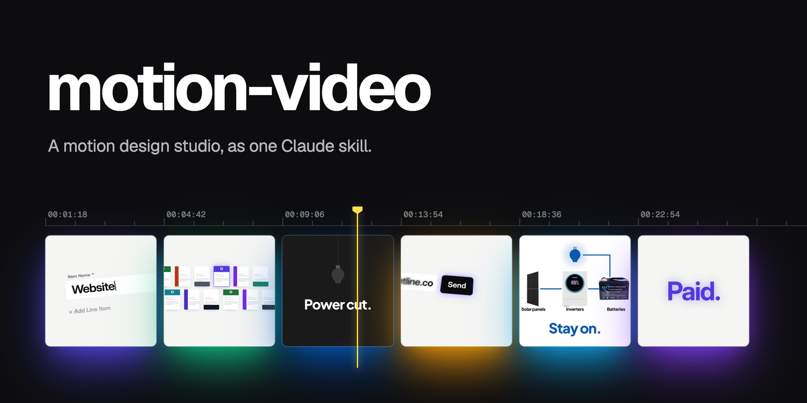
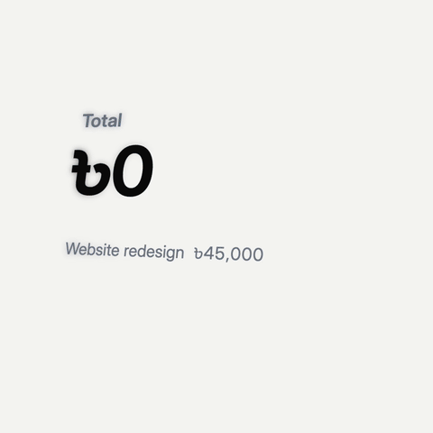
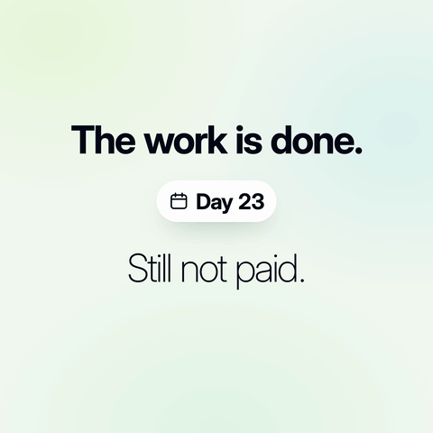
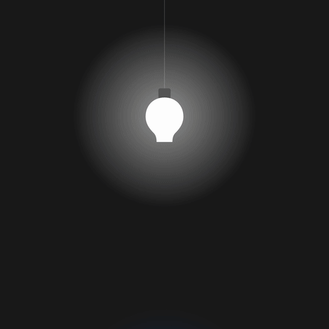
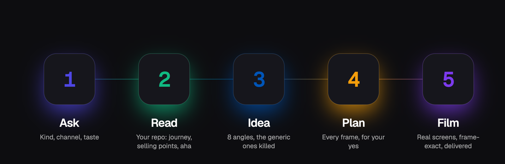
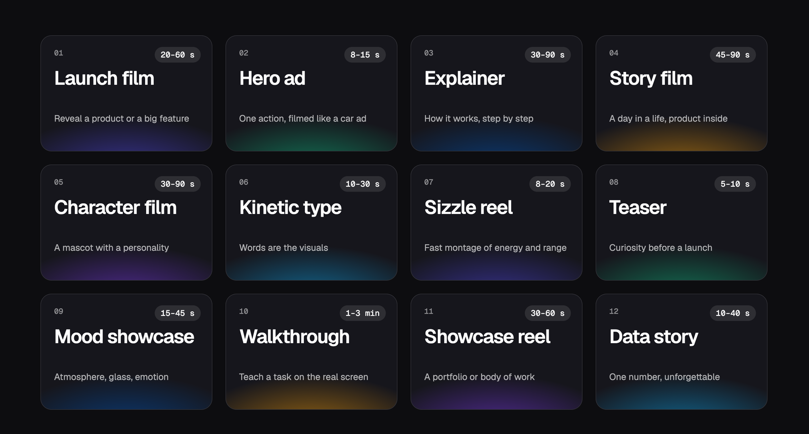

<p align="center"></p>

<p align="center">
  <a href="#install"></a>
  <a href="#twelve-kinds-of-video"></a>
  <a href="#the-craft-inside"></a>
  <a href="#how-a-frame-is-made"></a>
  <a href="#install"></a>
  <a href="#install"></a>
  <a href="LICENSE"></a>
</p>

Ask Claude for a launch video. It reads your product, finds an original idea, plans every frame, and animates your real screens in code: frame-exact, in your fonts and colours, ready to post.

<table>
<tr>
<td width="33%"><a href="examples/envoise-launch.mp4"></a></td>
<td width="33%"><a href="examples/envoise-connected.mp4"></a></td>
<td width="33%"><a href="examples/suntrigo-launch.mp4"></a></td>
</tr>
<tr>
<td><sub><b>Envoise</b> · invoicing app<br>Typing close-ups that follow the caret, a total that counts itself, a wall of invoice designs diving into one, "Paid."</sub></td>
<td><sub><b>Envoise</b> · connected screens<br>One invoice's life with no cuts: the app becomes the invoice, the invoice an email attachment, then PAID, then the dashboard.</sub></td>
<td><sub><b>Suntrigo</b> · solar shop<br>A power cut, the sun rising, panel → inverter → battery wiring up until the bulb lights, then buying it online.</sub></td>
</tr>
</table>

<sub>Click a preview for the full video. Silent here; music is mixed per channel. All three were built from the real products' code and screens.</sub>

## How it works

<p align="center"></p>

1. **It asks.** What kind of video, where it's going, and your taste: look, tone, sound, must-show moments, things to avoid. Every question has a default, so you can just say "go".
2. **It reads your product.** Your repo (read-only), screenshots or site: the user journey screen by screen, the selling points ranked, the aha moment, the brand. It writes a short brief and waits for your yes.
3. **It finds an original idea.** Eight concepts from eight angles (a moment in a life, the physical world, a character, pure type, one number, a borrowed format, one continuous shot…). Anything generic is thrown out.
4. **It plans every frame.** The whole film on one page, the look, every shot with every visible change timestamped, and key frames as stills, for your approval.
5. **It makes the film.** Real screens, smooth camera, motion blur, voice-over fitting and music, delivered for each channel with a thumbnail and post copy.

## Twelve kinds of video

<p align="center"></p>

Each kind has its own playbook: what to ask, story shapes, looks, moves and pitfalls.

<details>
<summary>The twelve kinds as text</summary>

| Kind | What it's for | Length |
|---|---|---|
| **Launch film** | Reveal a product or a big feature | 20–60 s |
| **Hero ad** | One action, filmed like a car ad | 8–15 s |
| **Explainer** | How it works: a workflow, a flow of data | 30–90 s |
| **Story film** | A person's day, with the product inside it | 45–90 s |
| **Character film** | A mascot with a personality carries it | 30–90 s |
| **Kinetic type** | Words are the visuals: updates, announcements | 10–30 s |
| **Sizzle reel** | A fast montage of energy and range | 8–20 s |
| **Teaser** | Curiosity before a launch | 5–10 s |
| **Mood showcase** | Atmosphere, glass UI, emotion | 15–45 s |
| **Walkthrough** | Teach a task step by step (training, how-to) | 1–3 min |
| **Showcase reel** | A portfolio or a body of work | 30–60 s |
| **Data story** | One number made unforgettable | 10–40 s |

</details>

## Why it's different

| | Template video tools | AI video generators | After Effects | **motion-video** |
|---|---|---|---|---|
| Your real UI, pixel-sharp | Mockups | Hallucinated | Yes, by hand | **Rebuilt from your code** |
| Understands your product | No | No | You explain it | **Reads the user journey** |
| Original concept | Same template | Random | If the designer is good | **8 angles, clichés banned** |
| Smooth, frame-exact motion | Yes | Wobbly | Yes | **Yes, with motion blur** |
| Change anything | Limited | Regenerate and hope | Hours | **Minutes** |
| Voice sync, music, delivery | Partial | No | Separate tools | **Built in** |

## The craft inside

<p align="center"></p>

- **36 ready-made moves:**
  - typing close-ups with a camera that follows the caret, and depth of field
  - a wall of results with a dive in or a zoom-out reveal
  - glowing prompt bars, streaming replies, thinking states, shimmer
  - scattered words assembling, one word growing into a sentence, word textures
  - iris, pixel and colour-sweep transitions
  - 3D before/after flips, scan-in reveals
  - lines drawing between nodes, tickers, notification stacks, lift-outs, press ripples
  - cursors with click-zoom, shared-element morphs
- **Motion tokens:** real easing curves, durations, springs, stagger, reading holds and phone text sizes, so motion is consistent and never guessed.
- **A field guide** from a frame-by-frame study of fifteen strong product films: what nearly all of them do, a dozen type techniques, fourteen transitions, and exactly when angled screens work (and when they don't).
- **An originality method** that runs before every concept, because the most common failure of AI-made video is that every video comes out the same.
- **Engineering that holds up:** smooth camera follows, GPU-cheap effects, frame-exact recording with film-style motion blur, voice fitting by time-warp, loudness-normalised mixing.
- **It learns your taste:** what you love and reject is saved and read before every new video.

## Install

### 1. Install the three tools it records with

It needs **Node.js 22 or newer**, **Google Chrome** (or Chromium) and **ffmpeg**.

**macOS** (with [Homebrew](https://brew.sh)):
```bash
brew install node ffmpeg
brew install --cask google-chrome      # skip if you already have Chrome
```

**Windows** (PowerShell):
```powershell
winget install OpenJS.NodeJS.LTS Gyan.FFmpeg Google.Chrome
```

**Linux** (Debian/Ubuntu):
```bash
sudo apt install ffmpeg chromium
# Node 22+: use nvm (https://github.com/nvm-sh/nvm), then:
nvm install 22
```

Check they're ready:
```bash
node -v        # v22 or higher
ffmpeg -version
```

### 2. Add the skill to Claude

**Claude Code: one line (recommended).** In Claude Code, type:
```
/plugin install motion-video --marketplace opsassad/claude-code-motion-graphic-video-skill
```

Or from a terminal:
```bash
claude plugin marketplace add opsassad/claude-code-motion-graphic-video-skill
claude plugin install motion-video@opsassad-skills
```

**Claude Code: by hand, for all your projects**
```bash
git clone https://github.com/opsassad/claude-code-motion-graphic-video-skill
mkdir -p ~/.claude/skills
cp -R claude-code-motion-graphic-video-skill/motion-video ~/.claude/skills/
```

**Claude Code: for one project only** (shared with your team through the repo)
```bash
mkdir -p .claude/skills
cp -R claude-code-motion-graphic-video-skill/motion-video .claude/skills/
```

**claude.ai:** zip the `motion-video` folder, then go to *Settings → Capabilities → Skills → Upload skill*. (Recording needs the tools above, so it works best in Claude Code on your own computer.)

### 3. Check it works

Ask Claude: *"Render the motion-video demo film to check my setup."* Or run it yourself from a clone of this repo; if it makes `demo.mp4`, everything is set up:
```bash
node motion-video/scripts/record.mjs motion-video/assets/moves-demo-2.html demo.mp4 --fps 30
```

Then start a new Claude Code session and ask for a video; Claude picks the skill up on its own.

**If Chrome isn't found** (it's somewhere unusual), point the recorder at it:
```bash
export CHROME="/path/to/chrome"
```

### Update

Installed as a plugin:
```bash
claude plugin update motion-video@opsassad-skills
```

Installed by hand:
```bash
cd claude-code-motion-graphic-video-skill && git pull
cp -R motion-video ~/.claude/skills/
```

Your saved taste (`~/.claude/motion-video-taste.md` or `MOTION_TASTE.md` in a project) is kept; updating only replaces the skill.

## Use

> Make a 30-second launch film for our invoicing app. The repo is ~/code/invoicer, it's for freelancers, and it's going on LinkedIn.

> Turn this how-to into a 2-minute training video for our support team, in Spanish, with captions.

> Here's a reference video I love. Make ours with that level of motion.

## Getting the best results

The skill does the heavy lifting, but what you give it decides how good the film is. In order of impact:

1. **Give it the real product.** The repo path (it only reads), the live URL, and screenshots of the key screens. Add brand files if you have them: the logo as SVG, font files, brand colours. Real material is the difference between *your* film and a generic one.
2. **Tell it the one thing.** Who exactly is it for, what should they feel or do afterwards, and which single feature would make someone switch. One clear answer beats a list of ten features.
3. **Show it what you love.** One to three reference videos, and *what* you love about them (the camera, the pace, the type, the mood). It studies them frame by frame and makes yours at that level, with your own idea.
4. **Spend your attention early.** Correct the product brief and pick the concept carefully; read the frame-by-frame plan and the key frames. A note on a still takes a minute; the same note after a render takes a render.
5. **Give precise feedback.** Say where (*"at 0:12"*), what's wrong (*"too slow"*, *"unreadable on a phone"*, *"off-brand blue"*, *"the angle looks forced"*) and what you love. It saves your taste and reads it before every future film, so each one gets closer to what you want.
6. **Bring real proof, and say what's private.** True numbers, results or quotes make a film persuasive; tell it what must never appear.
7. **Bring the sound.** A recorded voice take (it writes the script for AI voice tools) and a music track you have the rights to. It fits the animation to the voice, not the other way round.
8. **Use a strong model for the thinking.** The concept and the plan benefit most from the most capable model; smaller models handle builds and small edits well.
9. **Expect a round or two,** then ask for the final render (sharper and with film-style motion blur), which takes a few minutes longer.

**A weak brief vs a strong one**

> ✗ *Make a video for my app.*

> ✓ *A 30-second launch film for Invoicer, for freelancers who hate chasing payments, posted on LinkedIn. The repo is ~/code/invoicer; the live site is invoicer.app. The thing that makes people switch: clients pay straight from the invoice by card. I love the pace and the close-up typing in this video: [link]. Don't show the pricing page; our "2,000 invoices paid" number is public.*

## What's inside

```
motion-video/
├── SKILL.md                     the workflow and the quality checklist
├── references/
│   ├── intake.md                intake questions, reading a repo, the product brief
│   ├── kinds/                   one playbook per kind of video (12)
│   ├── originality.md           8 angles, kill tests, banned clichés
│   ├── plan.md                  the frame-by-frame production plan
│   ├── patterns.md              field guide from 15 strong launch films
│   ├── styles.md                12 looks
│   ├── craft.md                 deep principles, composition, motion vocabulary
│   ├── motion-tokens.md         easing, durations, springs, text sizes, beats
│   ├── moves.md                 the moves library, with options
│   ├── engine.md                the render(t) contract, smooth cameras, pitfalls
│   ├── voice-and-sound.md       AI voice scripts, pronunciation, fitting, mixing
│   ├── delivery.md              channel specs, thumbnails, post copy, privacy
│   ├── genres.md                defaults per channel and audience
│   └── taste.md                 lessons from real client feedback
├── scripts/
│   ├── record.mjs               frame-exact recorder (video or stills, --scale, --blur)
│   ├── contact-sheet.sh         stills → one review image
│   ├── study-reference.sh       a reference video → frame-by-frame sheets
│   ├── voice-segments.mjs       find each spoken line in a voice take
│   └── mix.mjs                  video + voice + ducked music → -14 LUFS mp4
└── assets/
    ├── motion.js                engine helpers + 36 moves
    ├── engine-starter.html      a page to start from
    ├── moves-demo.html          core moves, used once each
    └── moves-demo-2.html        field-guide moves, used once each
```

## How a frame is made

Each video is a web page with one function, `render(t)`, that draws the exact frame at time `t`: no timers, no randomness, the same `t` always gives the same picture. A recorder opens the page in headless Chrome, asks for every frame in turn (optionally several sub-frames, blended into film-style motion blur) and streams them into ffmpeg. So it never drops a frame, renders at any size, and lets a voice-over set the timing exactly.

```bash
record.mjs film.html out.mp4                          # 1080p, 60 fps
record.mjs film.html out.mp4 --scale 2 --blur 4       # rendered at 4K detail, scaled down, with motion blur
record.mjs film.html out.mp4 --scale 2 --keep-scale   # true 4K output (3840×2160 from a 1920×1080 page)
record.mjs film.html stills/ --stills 1,4.5,9         # still frames for review
```

## Questions

**Does it touch my code or servers?** No. It only reads your repo. It never edits it, opens secret files, logs in, or calls live services.

**Can it make something like a video I love?** Give it the video. It studies it frame by frame (camera, type, colour, transitions, tempo) and makes yours at that level, with your own idea.

**Which models does it work with?** It's written for Claude. The ready-made moves and tools carry a lot of the work, so smaller models make clean videos too; the strongest models find the best ideas.

**Voice and music?** It writes voice-over scripts formatted for AI voice tools, fits the animation to your recorded take, and mixes your music under it at social-media loudness. You bring the voice and a track you have the rights to.

## Contributing

Contributions are welcome: new moves, kind playbooks, lessons from great videos, Windows and Linux support, bug fixes, and examples made with the skill. Every visual change comes with proof (stills or a clip), and nothing may push videos toward a template. Read [CONTRIBUTING.md](CONTRIBUTING.md) before opening a pull request, and share what you made with the "Show what you made" issue template.

## License

MIT. Use it, fork it, make beautiful things.
